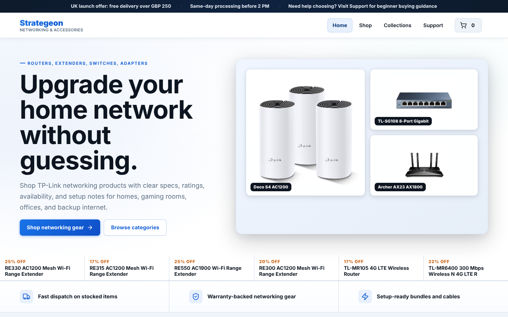
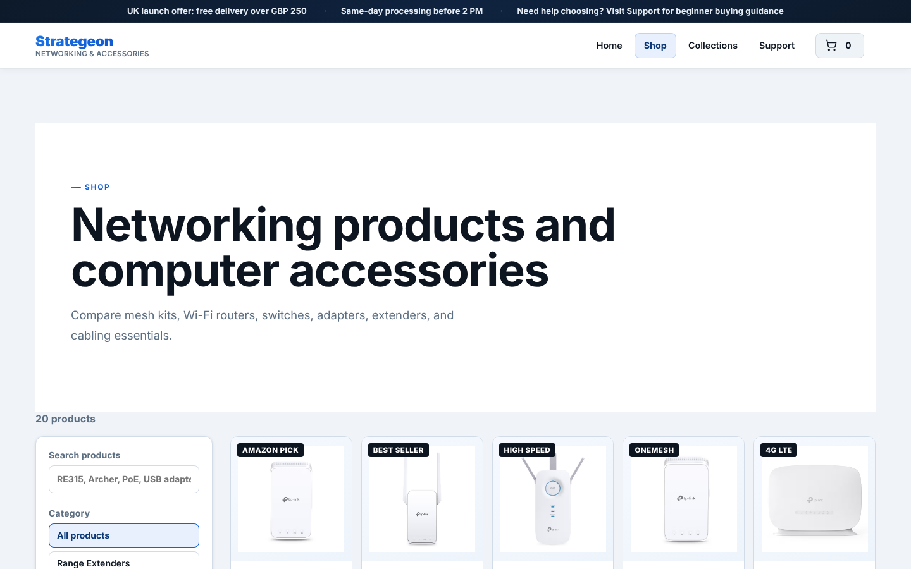

<div align="center">

# 🛒 Strategeon: Networking & Accessories Store

A UK e-commerce storefront for TP-Link networking gear (routers, mesh Wi-Fi, range extenders, 4G LTE routers, switches and adapters), built with Next.js 16 and React 19, with **Stripe Checkout** for real card payments.

[](https://strategeon-llc.vercel.app)


### 🔗 Live site: **https://strategeon-llc.vercel.app**



</div>

---

## Features

**Shopping**
- Home page with hero, featured deals, category tiles, trust badges and customer feedback
- Shop page with search, category filters and sorting across 20 products
- Collections page grouped by product type
- Product pages with image gallery, key specs, stock status and rating, plus technical overview, what's in the box, compatibility and after-sale support sections
- Quick-view pop-up from any product grid
- Cart drawer with quantity controls; the cart is saved in `localStorage`
- Free UK delivery over £250, otherwise a flat £15 delivery charge
- Support page with plain-English buying guides (coverage planning, speeds and ports, PoE, setup help), plus a newsletter sign-up

**Payments (Stripe Checkout)**
- `POST /api/checkout` builds the Stripe session on the server from the product catalogue, so prices cannot be changed from the browser (quantities are clamped to 1–99)
- Card payments in GBP, UK shipping address collection, delivery charge added automatically
- Success page shows an itemised order confirmation fetched from Stripe; cancel page returns the shopper to the cart
- `POST /api/webhooks/stripe` verifies the Stripe signature and handles completed, async-succeeded and failed payments

**SEO**
- Per-page metadata, Open Graph tags and a canonical URL
- JSON-LD structured data: `Organization` on the home page and `Product` (with offer and rating) on every product page
- Statically generated product pages, `sitemap.xml` and `robots.txt`
- Optimised images with `next/image`

## Screenshots

| Home | Shop |
|---|---|
|  |  |

## Tech stack

| Layer | Tools |
|---|---|
| Framework | Next.js 16 (App Router), React 19 |
| Payments | Stripe Checkout + webhooks (`stripe` Node SDK) |
| Styling | Tailwind CSS 4 and custom CSS, Lucide icons |
| Hosting | Vercel |

## Getting started

**Requirements:** Node.js 20.9 or newer and a [Stripe account](https://dashboard.stripe.com/register) (test mode is fine).

```bash
git clone https://github.com/ZainAftab-dev/StrategeonLLC.git
cd StrategeonLLC
npm install
```

Create `.env.local` in the project root:

```bash
STRIPE_SECRET_KEY=sk_test_...        # Stripe Dashboard → Developers → API keys
STRIPE_WEBHOOK_SECRET=whsec_...      # only needed to receive webhooks
```

Run the development server:

```bash
npm run dev
```

Open [http://localhost:3000](http://localhost:3000). On Windows you can also double-click **`Run Website.bat`**, which installs dependencies, builds and starts the site.

**Test a payment:** add items to the cart, press Checkout, and pay with Stripe's test card `4242 4242 4242 4242`, any future expiry date and any CVC.

**Test webhooks locally** with the [Stripe CLI](https://docs.stripe.com/stripe-cli):

```bash
stripe listen --forward-to localhost:3000/api/webhooks/stripe
```

## Project structure

```
app/
├── layout.jsx                    # metadata, fonts, Open Graph
├── page.jsx                      # home page + Organization JSON-LD
├── shop/  collections/  support/ # store pages
├── product/[id]/page.jsx         # static product pages + Product JSON-LD
├── checkout/success/             # itemised order confirmation
├── checkout/cancel/
├── api/checkout/route.js         # creates the Stripe Checkout session
├── api/webhooks/stripe/route.js  # verifies and handles Stripe events
├── [...slug]/page.jsx            # client-side routes and 404
├── sitemap.js  robots.js
src/
├── App.jsx                       # store UI: header, pages, product grid, quick view, cart drawer, footer
└── styles.css
lib/
└── products.js                   # product catalogue (name, price, specs, stock, rating, images)
public/images/                    # product photos and category artwork
docs/ecommerce-design-source.md   # design brief for the storefront
```

## Deployment (Vercel)

1. Import the repository at [vercel.com/new](https://vercel.com/new).
2. Add `STRIPE_SECRET_KEY` and `STRIPE_WEBHOOK_SECRET` under **Settings → Environment Variables**.
3. In the Stripe Dashboard, add a webhook endpoint `https://<your-domain>/api/webhooks/stripe` for the `checkout.session.*` events.
4. Deploy.

## Roadmap

- Save confirmed orders to a database (the webhook currently logs them)
- Customer accounts and order history
- Stock levels managed from an admin page

## Author

**Zain Aftab**, founder of Strategeon · [GitHub](https://github.com/ZainAftab-dev) · [LinkedIn](https://www.linkedin.com/in/zain-aftab-563727295/)
